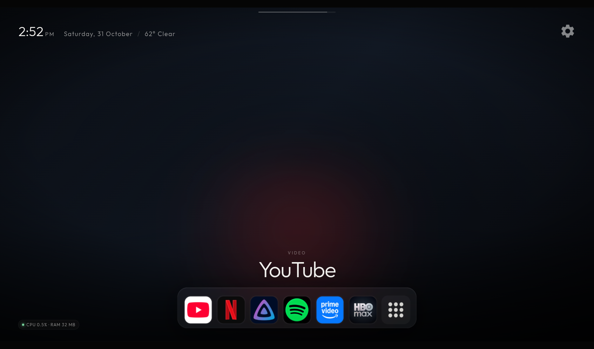
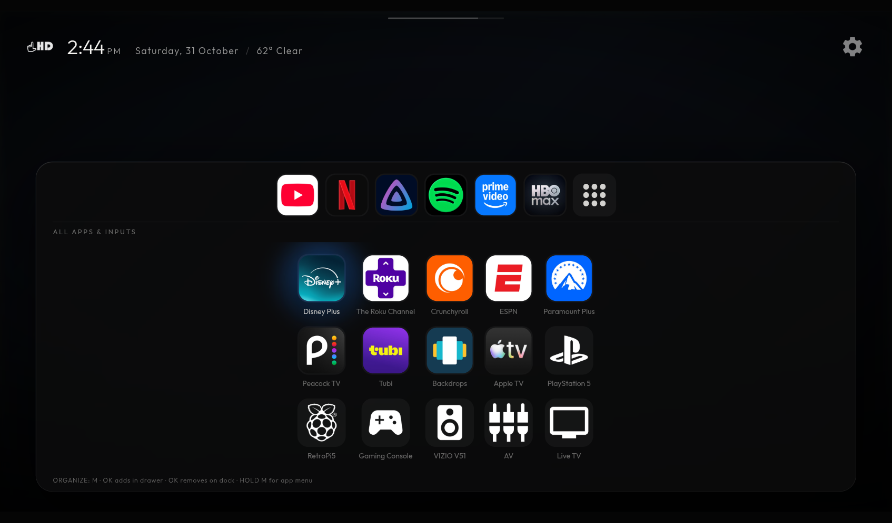

# LHD Launcher


A clean, motion-forward **launcher and screensaver for Roku TV**, built as a sideloadable SceneGraph channel. It replaces the stock home screen with your own dock, an all-apps drawer, a top-shelf app name, a brand-coloured spotlight, an Immich photo screensaver, clock/weather, and an optional process monitor.

No root, no OS replacement, no firmware flashing — just a developer-mode channel plus a small helper on your LAN.




## Features

- **Your dock, your order** — favourites plus an All-apps tile; hold **OK** to pick an app up, arrows to place it, OK to drop.
- **One drawer, two jobs** — browse all apps or organize them (hold OK to move, short OK to add/remove).
- **Top-shelf name** — category + app name with a brand-coloured ambient glow.
- **Brand spotlight** — a large, coloured focus light behind the selected tile (no zoom, no focus ring).
- **Glass drawer** — the dock expands upward into a rounded panel with the dock row at the top.
- **Immich screensaver** — random photos from an album, crossfaded, with a top-left clock/date/weather.
- **Official icons** — crisp 512 px app-store icons, plus input/stock icons and a Switch/PlayStation/Raspberry Pi icon picker.
- **LHD home tile** — the hand+HD mark is the channel icon on the Roku home screen (`mm_icon_focus_fhd` 540×405 and `mm_icon_focus_hd` 290×218), with a branded launch splash.
- **Rename and re-icon anything** — hold ✱ on an app: Rename, Change icon, Restart.
- **Process monitor** — CPU/RAM of the launcher process, toggleable in Settings. Roku only exposes per-channel stats via ECP, not system-wide.
- **Home returns to LHD** — pressing Home from anywhere (including inside LHD) bounces back to the launcher in about a second. Roku's Home screen still flashes briefly: the Home key is firmware-reserved and cannot be intercepted by channels. Use Settings → Roku Home (10 min) or Disable auto-start to stay on Roku.

## How it works

```
Roku TV ── ECP :8060 ── helper (Docker, LAN :8099) ── Immich API
   │                         │
   └──── HTTP /photo ────────┘
```

- The **channel** is SceneGraph/BrightScript; it talks only to the helper.
- The **helper** is a small Python service that bridges Roku ECP (apps, launch, keys, chanperf), proxies Immich photos, and serves weather-adjacent/status endpoints.
- Nothing is exposed to the internet. The channel and helper are LAN-only.

## Requirements

- A Roku TV/player with **developer mode** enabled (tested on a TCL 55S555, Roku OS 16.0.4). Reserve a static DHCP lease for it.
- A always-on Linux host on the same LAN for the helper (NAS, Raspberry Pi, mini PC) with Docker, or Python 3.11+.
- Optional: an **Immich** server and API key with `asset.read` + `asset.view` for the screensaver.

## Quick start

### 1. Helper

```bash
cp helper/.env.example helper/.env
$EDITOR helper/.env          # TV_IP, IMMICH_URL, IMMICH_ALBUM_IDS
cd helper
docker compose up -d --build
```

Check it:

```bash
curl http://<helper-ip>:8099/health
curl http://<helper-ip>:8099/apps
```

Set the Immich key without exposing it in shell history:

```bash
cd helper
./set-immich-key.sh          # hidden prompt, writes .env (chmod 600)
./set-immich-album.sh        # optional album filter
```

### 2. Point the channel at the helper

Edit **one file**:

```brightscript
' channel/source/config.brs
function lhdHelper() as String
    return "http://192.168.1.50:8099"
end function
```

For the browser preview, edit `HELPER` at the top of `preview-motion.html`.

### 3. Build and sideload

```bash
./build.sh
TV_IP=<tv-ip> ./install-channel.sh
```

`install-channel.sh` asks for the **Roku developer password** (hidden, never stored) and uploads the zip. Answer `y` to launch. The install script needs the TV's developer mode password, not your Roku account password.

### 4. Set the screensaver

On the TV: **Settings → Screen saver → LHD Screensaver** (the channel advertises `LHD Screensaver`).

### 5. Optional: reserve/verify

```bash
curl http://<tv-ip>:8060/query/active-app
```

## Controls

| Input | Action |
| --- | --- |
| Arrows / OK | Move / launch |
| **Short ✱** | Toggle organize mode |
| **Hold ✱** | App options: Rename, Change icon, Restart launcher |
| **Hold OK** (organize) | Pick up an app; arrows place it; OK drops |
| **Short OK** (organize) | Add (drawer) / remove (dock) |
| **Back** | Close drawer / cancel move / exit organize |
| Cog | Settings; the shelf reads **Settings** when the cog is focused (photo interval, monitor, Home/Store/Settings pauses, auto-start) |

In the drawer, `ORGANIZING` shows the live key hints. The picked-up app gets a gold ring, a lift/scale, a gold spotlight and a `MOVING` banner.

## Configuration

| Where | What |
| --- | --- |
| `helper/.env` | `TV_IP`, `IMMICH_URL`, `IMMICH_API_KEY`, `IMMICH_ALBUM_IDS`, `AUTO_LAUNCH`, `LAUNCHER_APP_ID` |
| `channel/source/config.brs` | Helper URL used by the TV channel |
| `preview-motion.html` | `HELPER` constant for the browser preview |
| `channel/images/app-<id>.png` | Official app icons (or use hold-✱ → Change icon) |

Registry keys written by the channel: `favorites`, `drawer_order`, `name_<id>`, `icon_<id>`, `photo_interval`, `monitor`.

## Using with an AI agent

This repo is structured to be driven by a coding agent (Claude Code, Codex, Cursor, etc.). Open the repo and paste:

```text
You are helping me install and customize LHD Launcher on my Roku TV.
Read README.md and AGENTS.md first.

Ask me for: TV_IP (the Roku), HELPER_IP (the NAS/Pi running the helper),
and whether I use Immich.

Then:
1. Copy helper/.env.example to helper/.env and set TV_IP, IMMICH_URL and
   IMMICH_ALBUM_IDS. Do NOT ask me to paste the Immich API key into chat —
   tell me to edit helper/.env myself or run helper/set-immich-key.sh.
2. Set channel/source/config.brs to http://HELPER_IP:8099.
3. Run ./build.sh.
4. Run TV_IP=<TV_IP> ./install-channel.sh. I will type the Roku developer
   password in the terminal. Never ask for, echo, or store that password.
5. Verify with curl http://<TV_IP>:8060/query/active-app and the Roku
   debug console on port 8085. Report any compile/runtime errors.

Never commit .env, credentials, or personal photos. Keep the LHD look:
Outfit type, monochrome glass, the LHD mark, no focus rings.
```

The included `AGENTS.md` has the project conventions, file map, and commands an agent needs.

## Repo layout

```
channel/                Roku SceneGraph channel
  components/           LauncherScene, ScreensaverScene, HttpTask
  source/               main.brs, config.brs (helper URL)
  images/               app/input/stock icons, glass assets, LHD mark/splash
  fonts/                Outfit Light/Regular
helper/                 Python ECP/Immich helper (Docker)
preview-motion.html     Current browser preview (serve from repo root)
preview.html            Earlier layout preview
build.sh                Zips channel/ → lhd-launcher.zip
install-channel.sh      Sideload + launch with the Roku dev password
docs/                   README art only
```

## Preview in a browser

```bash
python3 -m http.server 8123
# open http://127.0.0.1:8123/preview-motion.html
```

The preview fetches `/tvstats` and `/photo` from your helper; if it is offline the UI still runs.

## Helper endpoints

`/health`, `/apps`, `/icon/<id>`, `/launch/<id>`, `/home`, `/tvstats`, `/restart`, `/photo`, `/albums`, `/auto-launch/off|on|pause?seconds=`.

## Security and privacy

- **Developer mode is required.** Keep the Roku developer password private; it is entered only at the install prompt and never stored by this project.
- **The helper has no authentication.** Keep it on your LAN, firewall port 8099, and never port-forward it.
- **Immich keys live in `helper/.env`** (gitignored). Use a read-only key if possible.
- **No personal photos are in this repo.** Screenshots use a neutral background; the screensaver reads your Immich library at runtime.
- **Roku ECP is unauthenticated on the LAN.** Treat 8060 like any other LAN control port.
- App icons are trademarks of their owners and are included for personal sideloading. The LHD/Left Hand Designs name and logo belong to the project author.

## Troubleshooting

- **Channel installs but returns to Home** — compile error. Read the TV debug console: `telnet <tv-ip> 8085` (or `nc <tv-ip> 8085`). Fix the BrightScript, rebuild, reinstall.
- **401 from the installer** — wrong Roku developer password, or developer mode is off. Reset it in the TV's Developer Settings.
- **Blank/empty app list** — the helper is unreachable. Check `/health`, `TV_IP`, and the LAN; the channel shows a toast.
- **Photos don't cycle** — check `IMMICH_*` and `/photo`; the interval is under Settings → Photo interval.
- **Home stays on Roku** — auto-start is paused or off. Use the Settings menu to resume it, or restart the helper; `/health` shows `auto_launch` and `paused`.
- **Preview shows no photos** — set `HELPER` in the preview; the helper must be reachable from your browser.

## Credits

Built by **shuff57 / Left Hand Designs**. See [ATTRIBUTION.md](ATTRIBUTION.md) for icons, fonts and trademarks.

Not affiliated with Roku, Inc., Immich, or any app vendor. Sideloading is unsupported by Roku; use at your own risk.

## License

Code: [MIT](LICENSE). Third-party assets retain their own licenses and trademarks.
